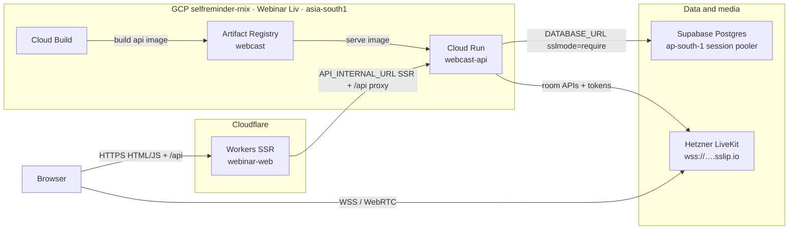
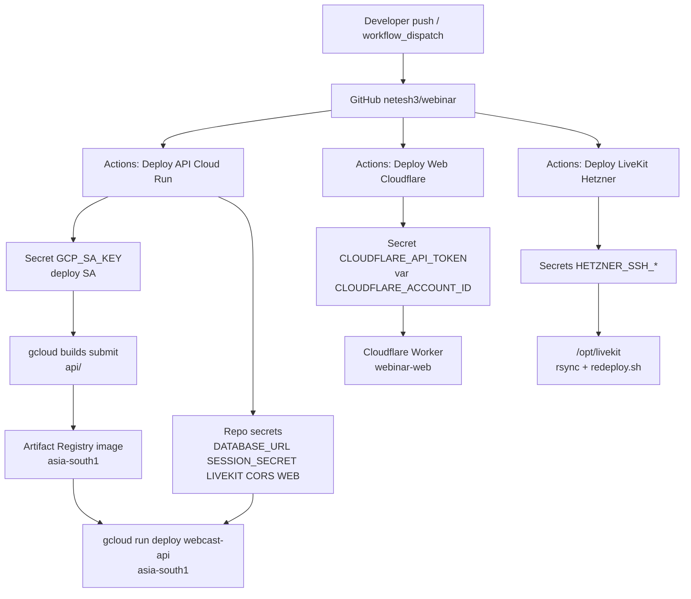

# Deployment topology (managed cloud)

This is the **current production-shaped** deployment: managed frontend, API, database, and SFU. It is separate from the path-mounted Kubernetes sketch in [`k8s/README.md`](../k8s/README.md). (The single-server Docker stack this document used to also distinguish itself from — `DEPLOY.md` / `DEPLOY-ANYWHERE.md` — was removed; it was only ever used for the earlier AWS setup.)

**Active topology is India-only** (API + images in GCP `asia-south1` / Mumbai; Postgres in Supabase `ap-south-1` / Mumbai).

| Layer | Where it runs | Public URL / endpoint |
|---|---|---|
| Frontend (Next.js 16 via OpenNext) | Cloudflare Workers | https://webinarliv.com (also https://webinar-web.ganesh-s-p006.workers.dev) |
| API (Go) | Google Cloud Run · `asia-south1` | https://webcast-api-65278594492.asia-south1.run.app |
| Postgres | Supabase · project `webinarliv` (`zxkcwibeqdkiuugfilvg`) · `ap-south-1` | session pooler `:5432` + `sslmode=require`  **Free plan since 2026-10-26**: no Supabase backups (nightly `pg_dump` to R2 instead, [BACKUPS.md](BACKUPS.md)) and a 500 MB cap (alert at 300 MB, [observability](observability.md#database-size-and-backups)) |
| Media SFU | Self-hosted LiveKit on an on-demand DigitalOcean droplet · `sfu-blr-1` (c-4, blr1), LiveKit project `do-blr` ([deploy/digitalocean](../deploy/digitalocean/README.md)). The Hetzner box (`webcast-livekit`, `88.198.141.104`) is sunset (2026-10-24): no new room goes there | `wss://152.42.156.192.sslip.io` |
| Recordings, clips, uploads, DB backups | Cloudflare R2 · one bucket (`RECORDINGS_S3_*`) | Private; played through signed links. Takes, clips, uploaded videos and `db-backups/` move to **Infrequent Access after 30 days** ([Apply R2 lifecycle](../.github/workflows/r2-lifecycle.yml), [BACKUPS.md](BACKUPS.md#storage-class-infrequent-access-after-30-days)); `covers/`, `avatars/`, `chat/`, `wa/` stay Standard |
| Images | Artifact Registry · `webcast` · `asia-south1` | `asia-south1-docker.pkg.dev/selfreminder-rnix/webcast/…` |
| CI / deploy | GitHub Actions → Cloud Run, Cloudflare Workers, the DigitalOcean video box | [cloudrun-deploy.yml](../.github/workflows/cloudrun-deploy.yml) · [cloudflare-workers-deploy.yml](../.github/workflows/cloudflare-workers-deploy.yml) · [livekit-do-deploy.yml](../.github/workflows/livekit-do-deploy.yml) |

GCP project: **`selfreminder-rnix`** (display name **Webinar Liv**). Deploy SA: `webcast-deploy@selfreminder-rnix.iam.gserviceaccount.com` (JSON key stored as GitHub secret `GCP_SA_KEY`). Repo variables **`GCP_PROJECT=selfreminder-rnix`**, **`GCP_REGION=asia-south1`**. Do not deploy Webinar Liv API into shared `ai-project-490516` (Sancharees / AI Studio).

### Deprecated (not active)

| Resource | Status |
|---|---|
| Cloud Run `webcast-api` in `us-central1` | Removed after India service was healthy (avoid double cost) |
| Artifact Registry `webcast` in `us-central1` | Left in place; unused — safe to delete later |
| Supabase `webcast` (`qiakwcylllwwvjymgmtz`) · `us-east-1` | Left in place as deprecated; fresh India DB was bootstrapped (no data dump migrated) |
| Single-VM `docker-compose.prod.yml` stack (`DEPLOY.md`, `DEPLOY-ANYWHERE.md`, `infra/ec2/`, `infra/portable/`) | Removed. Used only for the earlier AWS setup; production has run the managed topology above since |

---

## Runtime topology

**Request paths**

1. **Page load / SSR** — browser → Cloudflare Worker → (optional) Go API via `API_INTERNAL_URL`.
2. **Browser API calls** — browser → Worker `/api/*` (same origin; `NEXT_PUBLIC_API_BASE` empty) → proxied to Cloud Run (`API_INTERNAL_URL`). Session cookie is first-party on the Worker host so middleware can gate Host/Admin/My webinars. Direct browser→Cloud Run is not used in this topology (cookie would land on `*.run.app` and middleware would bounce authenticated routes to login).
3. **Media** — browser ↔ Hetzner LiveKit directly (API only mints JWTs and calls room APIs; media UDP/TCP never goes through Cloud Run).
4. **Edge audience video** — plain HLS (fMP4, 1s segments, ~3s behind live; 2s and ~6s until 2026-10-26) from MediaMTX on the video box at `/live/<slug>/index.m3u8`, played either **directly from the box** or **through the Bunny pull zone**, chosen per viewer at join: with `EDGE_NEAR_COUNTRIES` (e.g. `IN`), viewers in those countries (or of unknown country) play the box, everyone else the CDN, each with the other as `fallbackPlaybackUrl`. The country comes from Cloudflare via the Worker's `X-Viewer-Country` header (the Worker drops the client's own CF-* headers). Moved from LL-HLS to plain HLS on 2026-10-25 after Bunny's request coalescing stalled LL-HLS blocking reloads for whole edges (89 viewers on one request); details in [edge-delivery.md](edge-delivery.md), and every delivery decision with its evidence in [decisions/2026-10-26-audience-delivery.md](decisions/2026-10-26-audience-delivery.md).

Health check on the API: **`GET /readyz`** (prefer this over `/healthz` on Cloud Run).

---

## Deploy / CI topology

| Trigger | What deploys |
|---|---|
| Push to `main` changing `api/**`, `deploy/cloudrun-deploy.sh`, `deploy/cloudrun.env.example`, or `.github/workflows/cloudrun-deploy.yml` | API → Cloud Run (auto) |
| Actions → **Deploy API (Cloud Run)** → Run workflow | API → Cloud Run (manual) |
| Push to `main` changing `web/**` or `.github/workflows/cloudflare-workers-deploy.yml` | Frontend → Cloudflare Workers (auto) |
| Actions → **Deploy Web (Cloudflare Workers)** → Run workflow | Frontend → Cloudflare Workers (manual) |
| Push to `main` changing `deploy/livekit-hetzner/**` or `.github/workflows/livekit-do-deploy.yml` | LiveKit → the DigitalOcean box `/opt/livekit` (auto, skipped while the box is down; does **not** overwrite `.env.keys`). Not `deploy/captions/**`: captions run only on the captions box, whose snapshot that change rebuilds (`sfu-snapshot.yml`); the video box is not restarted |
| Actions → **Deploy LiveKit (DigitalOcean)** → Run workflow | LiveKit → the DigitalOcean box (manual) |
| `cd web && npm run deploy` (OpenNext) | Frontend → Cloudflare Workers (local / fallback) |

Required GitHub **secrets** (Cloud Run): `GCP_SA_KEY`, `DATABASE_URL`, `SESSION_SECRET`, `LIVEKIT_URL`, `LIVEKIT_API_KEY`, `LIVEKIT_API_SECRET` (or `LIVEKIT_PROJECTS`).  
Required (Cloudflare Workers): `CLOUDFLARE_API_TOKEN`.  
Required (DigitalOcean video box): `DO_SSH_HOST`, `DO_SSH_PRIVATE_KEY`, `DO_API_TOKEN` (the API creates and deletes the droplet), repo variable `SFU_BOX_PROJECT`. Optional: repo variables `SFU_BOX_SLOTS`, `SFU_BOX_AREA`, `SFU_BOX_CAPACITY` and `SFU_BOX_POINTS` make it a pool of several boxes, placed by region and capacity points (`deploy/digitalocean/README.md` "More video servers"). The Hetzner secrets (`HETZNER_SSH_HOST`, `HETZNER_SSH_PRIVATE_KEY`) are no longer read by any workflow.  
Optional: `CORS_ORIGINS`, `WEB_BASE_URL`, `ADMIN_EMAILS` / `ADMIN_PASSWORD` (bootstrap production admin on fresh DB).  
Repo **variables**: `GCP_PROJECT`, `GCP_REGION` (= `asia-south1`), `CLOUDFLARE_ACCOUNT_ID`.

Local mirror of env (gitignored): [`deploy/cloudrun.env`](../deploy/cloudrun.env.example). Supabase notes: [`deploy/SUPABASE.md`](../deploy/SUPABASE.md). LiveKit on Hetzner: [`deploy/livekit-hetzner/README.md`](../deploy/livekit-hetzner/README.md). Frontend Worker notes: [`web/CLOUDFLARE.md`](../web/CLOUDFLARE.md).

### Deploy guard (no deploy while a session is live)

Every deploy job's first step is [`.github/scripts/wait-no-live.sh`](../.github/scripts/wait-no-live.sh). It asks the production API's `GET /api/internal/live-status` (header `X-Tick-Secret: $TICK_SECRET`; mounted only when `TICK_SECRET` is set, same as `/api/internal/tick`). The answer is `{live: [{slug, kind, state, project, startsAt, startedAt}], count, byProject}`. A session counts when it is `live` (webinar, meeting or simulive), a simulive with its doors open, or `starting-soon` (scheduled within the next 10 min, or up to 15 min past its start without the host pressing Start). `project` is the room's LiveKit project (pin, else the host's assigned project, else the default), or `zoom`. It returns slugs only, no PII. The answer also has `finalizing`: sessions that ended under 35 min ago whose AI recap is still waiting for the after-session transcript (state `finalizing`). No deploy waits for these: the caption agent making that transcript runs on the separate captions box, which no deploy restarts. They are not in `live`, `count` or `byProject`.

While anything in scope is live, the job prints the blocking slugs and re-checks every 60 s for up to 3 h, then deploys as soon as nothing is live. After 3 h it fails.

| Workflow | Waits for | If the API cannot answer |
|---|---|---|
| Deploy API (Cloud Run) | any session | proceeds when the API is down (`/readyz` fails) or predates the endpoint (404), because the deploy is the fix; otherwise retries 10 min, then fails |
| Deploy Web (Cloudflare Workers) | any session | retries 10 min, then **fails** |
| Deploy LiveKit (DigitalOcean) | sessions on `do-blr` (var `DO_LIVEKIT_PROJECT`) | retries 10 min, then **fails** (the box restart would cut off everyone on it) |

The 10-minute retry covers a merge that ships the API and a box change together: the box deploy waits while the new API rolls out.

**Override** (each skips the guard and logs a warning):
- one run by hand: Actions → the workflow → Run workflow → tick **force**;
- one merge: put `[skip guard]` in the PR title (it lands in the merge commit message) or in a pushed commit's message;
- every deploy until undone: repo variable `DEPLOY_GUARD_SKIP=true` (`gh variable set DEPLOY_GUARD_SKIP --body true`; remove it with `gh variable delete DEPLOY_GUARD_SKIP`).

A video box deploy restarts LiveKit, so skipping its guard disconnects a live session for ~30–60 s; API and web deploys don't affect a live room. Optional repo variable `LIVE_STATUS_API_BASE` changes the API it asks (default `https://webcast-api-65278594492.asia-south1.run.app`).

**Queueing:** each workflow keeps its concurrency group (`cancel-in-progress: false`). While one run waits, a newer push replaces any run still pending in the group, so the newest commit deploys once the sessions end and deploys do not pile up.

---

## Trust boundaries and what each piece owns

| Component | Owns | Does not own |
|---|---|---|
| Cloudflare Worker | HTML/SSR, static assets, edge routing | WebRTC media; durable DB |
| Cloud Run API | Auth sessions, webinar state, LiveKit tokens, chat/polls APIs | Media forwarding; long-lived disk recordings (disabled: `RECORDINGS_ENABLED=false`) |
| Supabase | Postgres schema + data; migrations applied on API boot / `make migrate` | Application logic |
| Hetzner LiveKit | Rooms, tracks, attendee `Hidden` / publish permissions | Business roles (those come from API JWTs + DB) |

---

## Environment shape on Cloud Run

| Variable | Role |
|---|---|
| `APP_ENV=production` | Strict secrets, secure cookies |
| `SEED_DEV=false` | No demo users |
| `RECORDINGS_ENABLED=false` | No writable disk volume on Cloud Run |
| `DATABASE_URL` | Supabase **session pooler** URI (`sslmode=require`); direct `db.*` may be IPv6-only |
| `SESSION_SECRET` | ≥32 bytes |
| `LIVEKIT_*` | Legacy trio → one LiveKit Cloud project |
| `CORS_ORIGINS` / `WEB_BASE_URL` | Frontend origins (`https://webinarliv.com` + workers.dev) |
| `ADMIN_EMAILS` / `ADMIN_PASSWORD` | Bootstrap admin at API boot (≥10 chars); GitHub secrets → Cloud Run env |
| `GOOGLE_CLIENT_ID` / `GOOGLE_CLIENT_SECRET` | First-party Google sign-in + Connect YouTube (see `deploy/SUPABASE.md`) |
| `VAPID_PUBLIC_KEY` / `VAPID_PRIVATE_KEY` / `VAPID_SUBJECT` | Web Push, optional (see below) |

**Web Push:** the installable app (`web/app/manifest.ts`, `web/public/sw.js`) works without
any configuration; notifications need a VAPID key pair. Generate it once with
`npx web-push generate-vapid-keys`, and store
the two values plus a contact (`VAPID_SUBJECT=mailto:support@…`) as the GitHub secrets
`VAPID_PUBLIC_KEY`, `VAPID_PRIVATE_KEY` and `VAPID_SUBJECT` (or in `deploy/cloudrun.env`);
`cloudrun-deploy.yml` passes them through when set. All three or none — the API refuses to boot
on a partial or mismatched set. Do not rotate the pair casually: every browser subscribed under
the old public key stops receiving pushes and has to opt in again. Sending rides the tick (the
realtime lane's `flushPush`, plus an immediate flush when a session goes live), so it needs the
same per-minute `/api/internal/tick` caller as reminders. Nothing on the web side needs the keys:
the browser fetches the public key from `GET /api/push/public-key`.

To check a deployment: Settings → Notifications → turn on "This device" → **Send test
notification**. On Android/desktop Chrome, Edge or Firefox that is all; on iPhone/iPad (iOS
16.4+) first Share → **Add to Home Screen** and open the app from there.

**Admin bootstrap:** set `ADMIN_EMAILS` + `ADMIN_PASSWORD` (≥10 chars) as GitHub secrets (or in `deploy/cloudrun.env`) and redeploy so `EnsureAdminAccount` / `PromoteAdmins` run. Production does not ship seeded `webcast-dev` accounts.

**Budget:** GCP project has a monthly billing budget (₹1,500 thresholds). No Cloud Run Monitoring alert policies yet.

---

## Related docs

| Doc | Scope |
|---|---|
| [`ARCHITECTURE.md`](../ARCHITECTURE.md) | Product/runtime behaviour (roles, SFU, API) |
| [`docs/CAPACITY.md`](CAPACITY.md) | Sizing / 500-attendee assumptions |
| [`deploy/SUPABASE.md`](../deploy/SUPABASE.md) | Managed Postgres for this topology |
| [`web/CLOUDFLARE.md`](../web/CLOUDFLARE.md) | OpenNext / Workers deploy |
